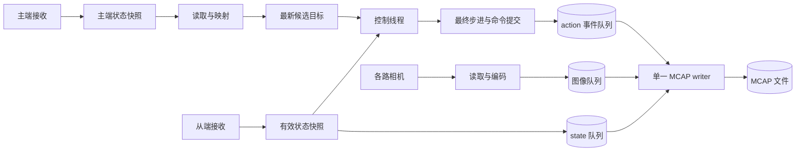
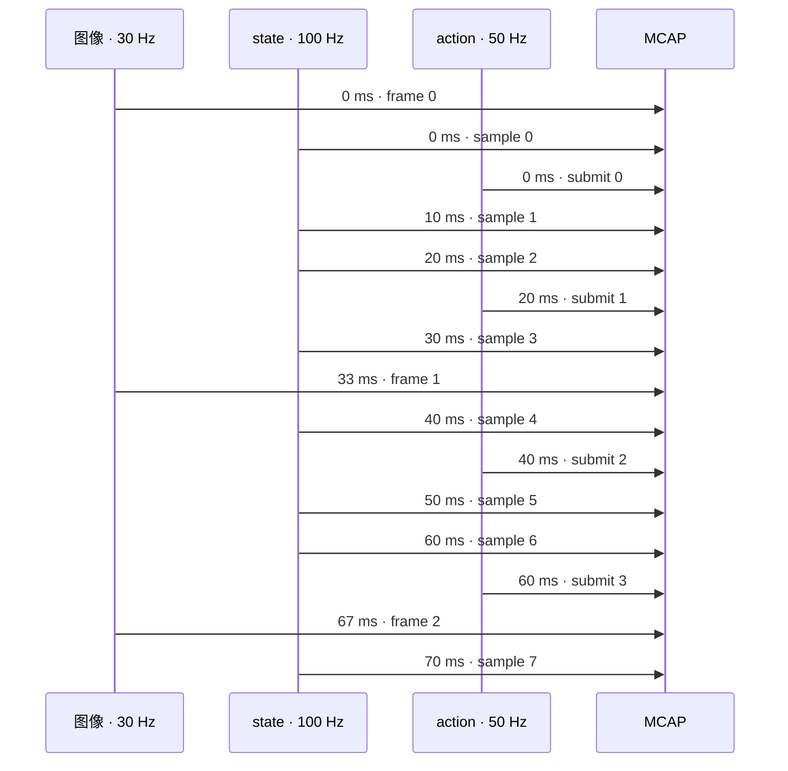

相机以 30 Hz 采图，机器人以 100 Hz 返回状态，控制器以 50 Hz 下发指令——这三条数据流应该怎样写进同一个文件？

直觉上，人们常想先把它们拼成一帧，再按某个统一频率保存。这样做会带来等待、补帧和降采样，也会模糊数据真正发生的时间。MCAP 提供了更自然的模型：**每条数据流保持自己的节拍，每条消息携带自己的时间戳，在同一容器中独立记录。**

本文给出这套录制方案的核心设计。

## 一份文件，四种频率

讨论“采集频率”前，先明确它指的是哪一层：

| 频率 | 含义 | 决定因素 |
| --- | --- | --- |
| 设备输出频率 | 相机产生图像、机器人上报状态的节拍 | 设备、驱动与配置 |
| 应用读取频率 | 应用从接收缓存中选取数据的节拍 | 采集线程 |
| 控制提交频率 | 控制线程向设备接口提交命令的节拍 | 控制循环与提交事件 |
| 实际记录频率 | MCAP 中每秒保存的有效消息数 | 有效样本、负载与运行状态 |

假设相机输出 60 FPS，而应用以 30 Hz 读取，稳定运行时每秒会记录约 30 张图像。机器人状态同理：设备可以更新得更快，录制线程只在 100 Hz 的采样点选取最新的有效快照。应用轮询快于设备时，则以版本号判断是否出现了新样本。

因此，配置频率描述调度目标；消息数量和时间戳描述实际结果。

## State、目标与 action

机器人链路中有几个相似但用途不同的量：

- **主端 state**：操作者输入设备的实际状态，是遥操作映射的输入。
- **候选目标**：主端 state 经过偏置、坐标或关节映射及合法性检查后得到的从端目标。
- **从端 state**：执行设备返回的实际状态，是数据集中的观测。
- **action**：控制线程完成步进限制和最终检查后，提交给设备接口的命令。

action 的记录点放在设备接口的提交处。这样，数据集保存的是控制器真正尝试执行的命令；提交结果、接口裁剪和错误状态随辅助信息一同记录。候选目标则留在控制链路内部，用来表达操作者当前的最新意图。

## 数据如何穿过系统

接收、控制和录制各自承担一件事：接收层发布不可变快照，控制线程只读取最新状态，录制线程按事件保存完整历史。

控制线程通过“最新值”缓存获得当下意图；录制线程通过事件队列保留每一次有效样本和命令提交。两种数据结构分别服务于实时性与完整性。

主端映射、从端采样和控制循环可以设置为不同频率。图像编码和磁盘写入始终留在控制线程之外，让控制周期的延迟只取决于控制计算与设备接口。

## MCAP 中的多频率时间线

MCAP 本质上是一本按时间索引的事件日志。每类数据使用独立 topic，各自保存消息，数量可以自然不同。

| 数据流 | Topic 示例 | 触发条件 | 典型节拍 |
| --- | --- | --- | --- |
| 各路图像 | `observations/images/<camera>` | 对应相机读取成功 | 每路约 30 Hz |
| 从端状态 | `observations/qpos` | 快照完整、有效且已更新 | 目标 100 Hz |
| action | `action` | 控制线程实际提交命令 | 跟随实际提交频率 |
| 辅助信息 | 对应 metadata topic | 与主消息同时生成 | 跟随对应消息 |

下面用 70 ms 的理想窗口展示三条数据流如何交错进入同一文件：

按这一组理想频率计算，一秒会产生约 90 条三路图像、100 条 state 和 50 条 action。实际间隔通常会围绕目标节拍波动，MCAP 直接保存这些真实时间。writer 的物理写入顺序只反映消费队列的先后，下游分析以消息时间戳重建时间关系。

## 时间戳：为每个字段定义语义

所有 topic 都映射到可比较的主机 Unix 时间；设备原始时钟同时保留，便于追踪和校准。

| 数据 | `publish_time` | `log_time` | 辅助时间信息 |
| --- | --- | --- | --- |
| 图像 | 设备帧时间映射到主机时钟后的值 | 应用取得帧的主机时间 | 原始设备帧时间、单位与时钟域 |
| state | 快照中最新分量的接收时间 | 应用完成快照组装的主机时间 | 各分量的接收时间与版本 |
| action | 命令提交开始时间 | 提交结束或失败时间 | 命令序号、来源状态与提交结果 |

图像消息的 `header.stamp` 复用 `publish_time`。单调时钟继续负责线程调度和耗时统计；Unix 时间负责跨 topic 比较。两套时钟各司其职，设备时间经过单位与时钟域映射后再参与对齐。

统一时间基准让消息可以比较，硬件同步则决定采样瞬间能否严格一致。需要分析图像与 state 的关系时，优先选择具有明确采样语义的 `publish_time`。

## 有效快照与 action 事件

state 往往由多个分量拼成。一次有效快照需要同时满足完整性、新鲜度和最大时间跨度要求，并携带各分量的时间与版本。100 Hz 是尝试采样的节拍；遇到未更新、过期或缺失的分量时，本轮跳过并计数。

action 则由提交事件驱动。控制线程先读取最新候选目标与有效 state，再执行步进限制和安全检查，最后在调用设备接口时生成事件。同值命令只要实际提交就会留下记录；一个周期包含多个子命令时，事件中分别标明完整提交、部分提交或失败。

这两个规则让数据含义保持清晰：state 描述设备反馈，action 描述控制器提交。

## 队列、背压与一次完整录制

每个数据源使用独立的有界队列，由单一 writer 公平消费。采集与控制线程采用非阻塞入队，队列满、读取超时、错过调度时隙、重复样本和状态过期分别计数。相机从 60 FPS 正常抽样到 30 Hz，也会与队列溢出造成的丢弃分开统计。

一轮录制生成 `<UUID>.mcap` 和同名 JSON：

- 启动时确认所需数据源就绪，再建立录制边界；
- 停止时先结束生产，再排空队列并关闭文件；
- JSON 分别汇总各 topic 的首末时间、消息数、实际频率、错误与丢弃计数；
- 文件完整性、数据语义版本和异常结束状态一并写入元数据。

图像模式仍可单独运行。新增 state 与 action 后，它们只是同一录制容器中的两条新数据流，不会改变相机链路的工作方式。

## 先忠实记录，再按任务对齐

录制阶段的目标是保留原始有效样本、真实提交事件和可信时间。固定频率的训练样本放到后处理阶段生成：先选择基准时间轴，再定义匹配容差、缺失值处理和插值策略。

验证也沿用同样的分层思路。先检查每个 topic 的频率、间隔分布、时间语义与丢弃统计，再评估跨 topic 的时间关系和多路并发负载。state 反馈频率、action 提交频率与机械臂的运动跟踪性能由不同指标描述。

这套方法把录制从“拼帧”改成“记事件”：在线路径保留每条数据流的真实节拍，离线阶段再根据任务构建统一样本。频率可以不同，但每条消息的来源、时间和结果都有迹可循。
